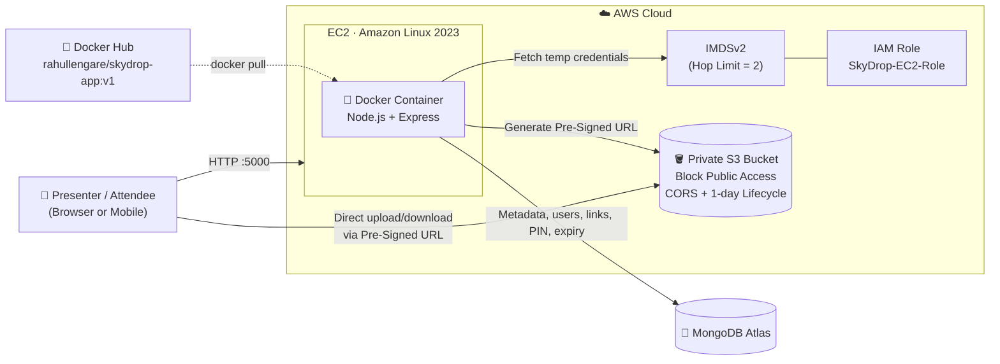

<div align="center">

# ☁️ SkyDrop — Cloud-Native Secure File-Sharing & Seminar QR Broadcasting Platform

**Cloud-native file-sharing platform on AWS EC2, Private S3 & Docker.**
Built for seminar hall QR sharing with drag-and-drop uploads, 4-digit PIN/password-protected links, custom expiry timers, storage quota & JWT auth — powered by S3 Pre-Signed URLs, IAM Roles (IMDSv2, zero hardcoded keys), 1-day S3 Lifecycle auto-delete, Node.js & MongoDB Atlas. 
SkyDrop is a containerized, cloud-native file-sharing web application deployed on AWS EC2, powered by Amazon S3, AWS IAM Roles, MongoDB Atlas, and Docker.   The architecture separates the Control Plane (Node.js/Express backend + MongoDB Atlas for authentication, file metadata, and expiring share tokens) from the Data Plane (Private Amazon S3 bucket using AWS S3 Pre-Signed URLs for direct, secure file uploads and downloads) without hardcoding any AWS credentials in the code or environment files.


**Repository:** `skydrop-aws-s3-docker-filesharing-platform`

</div>

## 🌟 Overview

**SkyDrop** is a cloud-native file-sharing platform designed for **seminar halls, lecture rooms, and workshops**, where a presenter needs to distribute slides or documents to dozens of mobile devices in seconds. The presenter uploads a file, SkyDrop generates a **scannable QR code**, and attendees download directly from **private Amazon S3** via **time-limited Pre-Signed URLs** — no accounts, no emails, no USB drives.

The platform is built around cloud security and cost-efficiency best practices:

- **No AWS keys anywhere** — the container obtains temporary credentials from an **IAM Role** through **IMDSv2**.
- **S3 is never public** — *Block All Public Access* is enabled, and files are only reachable via short-lived signed links.
- **Zero storage creep** — an S3 **Lifecycle Rule** deletes objects after one day.

---

## 🚀 Key Features & Use Cases

| Feature | Description |
|---|---|
| 📱 **Instant QR Code Broadcasting** | Generates a scannable QR popup so presenters can broadcast files/slides in seminar halls and lecture rooms to multiple mobile devices instantly. |
| 🔐 **Password & 4-Digit PIN Protection** | Secure sensitive shared files with a PIN before download. |
| ⏱️ **Flexible Custom Expiry Timers** | Custom expiration options from **5 minutes to 24 hours**. |
| ☁️ **Zero Hardcoded AWS Credentials** | AWS IAM Role (`SkyDrop-EC2-Role`) with **IMDSv2 (Hop Limit = 2)** for secure credential fetching from inside the container. |
| 🔒 **Private S3 + Pre-Signed URLs** | *Block All Public Access* enabled; direct, secure transfers via time-limited S3 Pre-Signed URLs and CORS. |
| ♻️ **Automated Cost Optimization** | S3 Lifecycle Rule automatically deletes objects after **1 day**. |
| 🐳 **Fully Containerized** | Node.js/Express backend packaged with Docker, pushed to Docker Hub, deployed on AWS EC2. |
| 🖱️ **Drag-and-Drop Uploads** | Clean, responsive UI for fast uploads from laptop or phone. |
| 🔑 **JWT Authentication & Storage Quota** | Authenticated sessions and per-user storage quota enforcement. |

---

## 🏗️ Architecture



**Request flow**

1. The presenter authenticates (JWT) and drags a file into the dashboard.
2. The backend assumes the **EC2 IAM Role** (via IMDSv2) and issues a **Pre-Signed URL** for the upload.
3. The browser uploads **directly to private S3** (CORS-enabled).
4. SkyDrop stores link metadata (expiry, PIN/password, owner) in **MongoDB Atlas** and renders a **share link + QR code**.
5. Attendees scan the QR, pass the PIN check, and download via a **time-limited Pre-Signed URL**.
6. After 1 day, the **S3 Lifecycle Rule** removes the object automatically.

---

## 🧰 Tech Stack

| Layer | Technologies |
|---|---|
| **Cloud Provider** | Amazon Web Services (AWS) |
| **Compute & Runtime** | AWS EC2 (Linux), Docker, Docker Hub |
| **Object Storage** | Amazon S3 (Pre-Signed URLs, CORS, Lifecycle Rules) |
| **Security & Identity** | AWS IAM Role & Custom Least-Privilege IAM Policy (IMDSv2) |
| **Backend & Frontend** | Node.js, Express.js, HTML5, CSS3, JavaScript, Tailwind/CSS |
| **Database** | MongoDB Atlas |

---

## 🛡️ Security Design

| Control | Implementation |
|---|---|
| **No static credentials** | EC2 Instance Profile → IAM Role → temporary STS credentials via IMDSv2 |
| **IMDSv2 enforced** | Session-token-based metadata access; `HttpPutResponseHopLimit = 2` so containers can reach it |
| **Least privilege** | Custom policy scoped to a single bucket and only the required S3 actions |
| **Private storage** | S3 *Block All Public Access* = ON; no bucket policy granting public reads |
| **Short-lived access** | Pre-Signed URLs expire; share links carry their own custom expiry (5 min – 24 h) |
| **Access gating** | 4-digit PIN / password verification before a download link is released |
| **Data minimization** | 1-day Lifecycle expiration limits retention and cost |
| **Secrets management** | Runtime secrets passed through `.env` (never committed to Git) |

---

## ✅ Prerequisites

- An **AWS account** with permissions for S3, IAM, and EC2
- A **MongoDB Atlas** account (free M0 tier is sufficient)
- A **Docker Hub** account
- **Docker** installed locally
- **AWS CLI v2** configured locally (`aws configure`) for the IMDS hop-limit command
- An EC2 **key pair** (`.pem`) for SSH

> 💡 Throughout this guide, replace placeholders such as `<YOUR_BUCKET_NAME>`, `<REGION>`, and `<INSTANCE_ID>` with your own values.

---

## 📘 Step-by-Step Implementation 

### Step 1 — Configure Private Amazon S3 Bucket, CORS & 1-Day Lifecycle Rule

**1.1 Create the bucket**

1. Open **S3 → Create bucket**.
2. **Bucket name:** `<YOUR_BUCKET_NAME>` (globally unique, e.g. `skydrop-files-<unique-suffix>`).
3. **Region:** choose your region (e.g. `ap-south-1`).
4. **Block Public Access:** keep **"Block *all* public access" ✅ enabled**.
5. Leave **Default encryption** enabled (SSE-S3).
6. Click **Create bucket**.

**1.2 Add the CORS configuration**

Go to **Bucket → Permissions → Cross-origin resource sharing (CORS) → Edit** and paste:

```json
[
  {
    "AllowedHeaders": ["*"],
    "AllowedMethods": ["GET", "PUT", "POST", "HEAD"],
    "AllowedOrigins": ["*"],
    "ExposeHeaders": ["ETag"],
    "MaxAgeSeconds": 3000
  }
]
```

> ⚠️ `AllowedOrigins: ["*"]` is convenient for a demo. For production, restrict it to your domain, e.g. `["https://skydrop.example.com"]`.

**1.3 Create the 1-Day auto-delete Lifecycle Rule**

Go to **Bucket → Management → Lifecycle rules → Create lifecycle rule**:

| Setting | Value |
|---|---|
| Rule name | `Auto-Delete-After-1-Day` |
| Rule scope | Apply to **all objects** in the bucket |
| Lifecycle rule actions | ✅ **Expire current versions of objects** |
| Days after object creation | **1** |

Optionally, also enable **Delete expired object delete markers or incomplete multipart uploads** → *Delete incomplete multipart uploads after 1 day*.

<details>
<summary><b>Optional: configure the same via AWS CLI</b></summary>

```bash
aws s3api put-bucket-lifecycle-configuration \
  --bucket <YOUR_BUCKET_NAME> \
  --lifecycle-configuration '{
    "Rules": [
      {
        "ID": "Auto-Delete-After-1-Day",
        "Status": "Enabled",
        "Filter": { "Prefix": "" },
        "Expiration": { "Days": 1 },
        "AbortIncompleteMultipartUpload": { "DaysAfterInitiation": 1 }
      }
    ]
  }'
```
</details>


---

### Step 2 — Create Least-Privilege AWS IAM Policy & IAM Role

**2.1 Create the custom policy — `SkyDrop-S3-Access-Policy`**

Go to **IAM → Policies → Create policy → JSON** and paste (replace the bucket name):

```json
{
  "Version": "2012-10-17",
  "Statement": [
    {
      "Sid": "SkyDropObjectAccess",
      "Effect": "Allow",
      "Action": [
        "s3:PutObject",
        "s3:GetObject",
        "s3:DeleteObject"
      ],
      "Resource": "arn:aws:s3:::<YOUR_BUCKET_NAME>/*"
    },
    {
      "Sid": "SkyDropBucketList",
      "Effect": "Allow",
      "Action": "s3:ListBucket",
      "Resource": "arn:aws:s3:::<YOUR_BUCKET_NAME>"
    }
  ]
}
```

Name it **`SkyDrop-S3-Access-Policy`** and create it.

**2.2 Create the IAM Role — `SkyDrop-EC2-Role`**

1. Go to **IAM → Roles → Create role**.
2. **Trusted entity type:** *AWS service* → **Use case: EC2**.
3. **Attach policy:** `SkyDrop-S3-Access-Policy`.
4. **Role name:** `SkyDrop-EC2-Role` → **Create role**.

The resulting trust relationship should look like this:

```json
{
  "Version": "2012-10-17",
  "Statement": [
    {
      "Effect": "Allow",
      "Principal": { "Service": "ec2.amazonaws.com" },
      "Action": "sts:AssumeRole"
    }
  ]
}
```

> ✅ This role will be attached to the EC2 instance in **Step 5**, so the application never needs an access key or secret key.


---

### Step 3 — Set Up MongoDB Atlas

1. **Create a cluster:** In [MongoDB Atlas](https://www.mongodb.com/cloud/atlas), create a **free shared (M0) cluster** in a region close to your EC2 instance.
2. **Create a database user:** *Security → Database Access → Add New Database User*
   - Authentication: **Password**
   - Username: `skydrop_user`
   - Password: a strong generated password (save it securely)
   - Role: **Read and write to any database** (or scoped to the `skydrop` database)
3. **Configure network access:** *Security → Network Access → Add IP Address*
   - Enter **`0.0.0.0/0`** (Allow access from anywhere) — convenient for this demo deployment.
   - 🔒 For better security, later replace it with your EC2 instance's **Elastic IP** (`<ELASTIC_IP>/32`).
4. **Get the connection URI:** *Database → Connect → Drivers → Node.js* and copy:

```text
mongodb+srv://skydrop_user:<password>@<cluster-name>.mongodb.net/skydrop?retryWrites=true&w=majority
```

> ⚠️ URL-encode special characters in the password (e.g. `@` → `%40`).


---

### Step 4 — Containerize with Docker & Push to Docker Hub

**4.1 `Dockerfile`** (project root)

```dockerfile
# ---- Base image ----
FROM node:18-alpine

# ---- Working directory ----
WORKDIR /app

# ---- Install dependencies (leverages layer caching) ----
COPY package*.json ./
RUN npm install --omit=dev

# ---- Copy application source ----
COPY . .

# ---- Expose application port ----
EXPOSE 5000

# ---- Start the server ----
CMD ["node", "server.js"]
```

> 📝 Adjust `server.js` to match your actual entry file (e.g. `app.js` or `index.js`).

**4.2 `.dockerignore`** (recommended)

```text
node_modules
npm-debug.log
.env
.git
.gitignore
README.md
```

**4.3 Log in, build, and push**

```bash
# 1. Authenticate with Docker Hub
docker login

# 2. Build the image
docker build -t rahullengare/skydrop-app:v1 .

# 3. (Optional) Test locally
docker run --rm -p 5000:5000 --env-file .env rahullengare/skydrop-app:v1

# 4. Push to Docker Hub
docker push rahullengare/skydrop-app:v1
```


---

### Step 5 — Launch AWS EC2 Instance, Attach IAM Role & Configure IMDSv2

**5.1 Launch the instance**

| Setting | Value |
|---|---|
| **Name** | `SkyDrop-Server` |
| **AMI** | Amazon Linux 2023 |
| **Instance type** | `t2.micro` / `t3.micro` (free-tier eligible) |
| **Key pair** | Create/select an existing `.pem` key pair |
| **IAM instance profile** | `SkyDrop-EC2-Role` *(Advanced details)* |
| **Metadata version** | `V2 only (token required)` |
| **Metadata response hop limit** | `2` |

**5.2 Security Group — inbound rules**

| Type | Protocol | Port | Source | Purpose |
|---|---|---|---|---|
| SSH | TCP | **22** | **My IP** (recommended) | Admin access |
| Custom TCP | TCP | **5000** | `0.0.0.0/0` | SkyDrop web app |

**5.3 Attach the IAM Role (if not done at launch)**

*EC2 → Instances → select instance → Actions → Security → **Modify IAM role** → `SkyDrop-EC2-Role` → Update IAM role.*

**5.4 Set IMDSv2 Response Hop Limit to 2**

By default, IMDSv2 uses a hop limit of **1**, which blocks containers (the extra Docker network hop drops the response). Setting it to **2** lets the SkyDrop container fetch IAM credentials securely while IMDSv2 stays enforced:

```bash
aws ec2 modify-instance-metadata-options \
  --instance-id <INSTANCE_ID> \
  --http-tokens required \
  --http-put-response-hop-limit 2 \
  --http-endpoint enabled \
  --region <REGION>
```

Verify the setting:

```bash
aws ec2 describe-instances \
  --instance-ids <INSTANCE_ID> \
  --query "Reservations[].Instances[].MetadataOptions" \
  --region <REGION>
```

Expected output:

```json
[
  {
    "State": "applied",
    "HttpTokens": "required",
    "HttpPutResponseHopLimit": 2,
    "HttpEndpoint": "enabled"
  }
]
```


---

### Step 6 — Deploy the SkyDrop Container on EC2

**6.1 SSH into the instance**

```bash
chmod 400 your-key.pem
ssh -i your-key.pem ec2-user@<EC2_PUBLIC_IP>
```

**6.2 Install and start Docker**

```bash
sudo dnf update -y
sudo dnf install docker -y
sudo systemctl start docker
sudo systemctl enable docker
sudo usermod -aG docker ec2-user
```

> Log out and back in (`exit`, then SSH again) so the `docker` group membership takes effect.

```bash
docker --version
```

**6.3 Create the `.env` file**

```bash
nano .env
```

```env
PORT=5000
MONGO_URI=mongodb+srv://skydrop_user:<password>@<cluster-name>.mongodb.net/skydrop?retryWrites=true&w=majority
JWT_SECRET=<generate-a-long-random-string>
AWS_REGION=<REGION>
S3_BUCKET_NAME=<YOUR_BUCKET_NAME>
```

Generate a strong JWT secret:

```bash
openssl rand -hex 32
```

> 🔐 **Notice there are no `AWS_ACCESS_KEY_ID` or `AWS_SECRET_ACCESS_KEY` entries.** The AWS SDK automatically obtains temporary credentials from the attached IAM Role via IMDSv2.

Lock down the file:

```bash
chmod 600 .env
```

**6.4 Run the container**

```bash
docker run -d -p 5000:5000 --env-file .env rahullengare/skydrop-app:v1
```

Optional hardening / ops flags:

```bash
docker run -d \
  --name skydrop \
  --restart unless-stopped \
  -p 5000:5000 \
  --env-file .env \
  rahullengare/skydrop-app:v1
```


**6.5 Verify the deployment**

```bash
docker ps
docker logs -f $(docker ps -q --filter ancestor=rahullengare/skydrop-app:v1)
```

(Optional) Confirm IMDSv2 credentials are reachable from inside the container:

```bash
CID=$(docker ps -q --filter ancestor=rahullengare/skydrop-app:v1)
docker exec -it $CID sh -c '
  TOKEN=$(wget -qO- --method=PUT --header="X-aws-ec2-metadata-token-ttl-seconds: 60" http://169.254.169.254/latest/api/token) &&
  wget -qO- --header="X-aws-ec2-metadata-token: $TOKEN" http://169.254.169.254/latest/meta-data/iam/security-credentials/
'
```

Expected output: `SkyDrop-EC2-Role`

---

### Step 7 — Live Testing & Verification

1. **Open the app** in your browser:
   ```text
   http://<EC2_PUBLIC_IP>:5000
   ```
2. **Register / log in** to receive a JWT-authenticated session.
3. **Upload a file** via drag-and-drop on the dashboard.
4. **Generate a share link** — choose an **expiry** (5 min → 24 h) and set a **4-digit PIN / password**.
5. **Open the QR popup** and scan it with a mobile device.
6. **Test PIN protection:**
   - ❌ Enter a wrong PIN → access denied.
   - ✅ Enter the correct PIN → download starts via a Pre-Signed S3 URL.
7. **Test expiry:** wait for the timer to elapse → the link should no longer work.
8. **Verify the backend:**
   - **S3 Console:** uploaded objects appear in the private bucket; "Object URL" access returns *AccessDenied* (proving the bucket is private).
   - **MongoDB Atlas → Browse Collections:** user and file/link documents are stored.
   - **S3 Lifecycle:** objects disappear after the 1-day rule runs.

| ✅ Verification Checklist | Expected Result |
|---|---|
| Direct S3 object URL (no signature) | `403 AccessDenied` |
| Pre-Signed URL within expiry | File downloads |
| Pre-Signed / share link after expiry | Request denied |
| Wrong PIN | Rejected |
| `docker ps` on EC2 | Container `Up`, port `0.0.0.0:5000->5000/tcp` |
| Instance metadata options | `HttpTokens: required`, hop limit `2` |


---

## 🧯 Troubleshooting

| Symptom | Likely Cause | Fix |
|---|---|---|
| `Could not load credentials from any providers` inside container | IMDS hop limit is 1 | Run the `modify-instance-metadata-options` command with `--http-put-response-hop-limit 2` |
| Browser upload fails with CORS error | Missing/incorrect S3 CORS rule | Re-check the CORS JSON in Step 1 |
| `AccessDenied` on upload/download | IAM policy bucket ARN mismatch or role not attached | Verify bucket name in the policy and the instance's IAM role |
| App unreachable at `:5000` | Security Group missing inbound rule | Add TCP 5000 inbound |
| `MongoServerSelectionError` | Atlas Network Access blocking EC2 | Add `0.0.0.0/0` or the EC2 Elastic IP in Atlas |
| `permission denied` on `docker` commands | User not in `docker` group | `sudo usermod -aG docker ec2-user`, then re-login |
| Container exits immediately | Missing/invalid `.env` values | Check `docker logs <container-id>` |

---

## 👤 Author

**Rahul Lengare**

- 🐋 Docker Hub: [`rahullengare/skydrop-app`](https://hub.docker.com/r/rahullengare/skydrop-app)
- 💼 LinkedIn: `<add-your-linkedin-url>`
- 🐙 GitHub: `<add-your-github-profile-url>`


